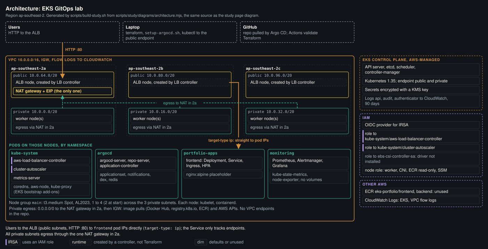

# EKS with GitOps: Terraform and Argo CD

[](https://www.terraform.io/)
[](https://aws.amazon.com/eks/)
[](LICENSE)
[](https://github.com/Simodalstix/AWS-eks-multi-tier-gitops/releases)
[](https://github.com/Simodalstix/AWS-eks-multi-tier-gitops/actions)

Lab: Terraform builds an EKS cluster, a bootstrap script installs the cluster
controllers and Argo CD, and Argo CD deploys a Helm chart and a monitoring stack
from this repository. The workload is an nginx placeholder (`nginx:alpine`).

## What's Provisioned

**AWS (Terraform, `infrastructure/`):**
- VPC across 3 AZs, public and private subnets, VPC flow logs
- One NAT gateway (`single_nat_gateway = true`)
- EKS 1.35, one managed node group: t3.medium or t3a.medium, Spot, AL2023, 1 to 4 nodes, in private subnets
- IRSA roles: AWS Load Balancer Controller, EBS CSI driver (role only, driver not installed), Cluster Autoscaler
- Node role with `AmazonSSMManagedInstanceCore` for Session Manager access
- ECR repositories `eks-portfolio/frontend` and `eks-portfolio/backend`, scan on push, lifecycle policies (no images are built or pushed by this repo)

**Kubernetes (`scripts/setup-argocd.sh`):**
- Argo CD v3.5.5
- AWS Load Balancer Controller (Helm, IRSA)
- metrics-server (Helm), the resource metrics source for the HPA
- Cluster Autoscaler (Helm, IRSA), scaling the managed node group within its
  1 to 4 node limits; it finds the ASG by the `k8s.io/cluster-autoscaler` tags
  set in `infrastructure/eks.tf`

**Argo CD applications (`argocd/applications/`):**
- `frontend`: `helm-charts/frontend`, nginx placeholder with Service, Ingress (internet-facing ALB, `target-type: ip`, HTTP only) and HPA (2 to 10 pods, 80% CPU)
- `monitoring`: kube-prometheus-stack 51.2.0 with `monitoring/prometheus-values.yaml`; Prometheus, Alertmanager and Grafana without persistent storage, plus 3 symptom alerts
- Both sync automatically with `prune` and `selfHeal`: Argo CD reverts manual changes to the resources it manages

## Architecture



_Generated by `scripts/build-study.sh` from `scripts/study/diagrams/architecture.mjs`, the same source as the study page. Traffic: ALB to pod IPs directly (`target-type: ip`). Workload: nginx placeholder. Deploys: Argo CD pulls from Git. CI: Terraform validation only, no image build._

Earlier diagram kept in diagrams/ for reference, not current.

## Project Structure

```
├── infrastructure/          # Terraform: VPC, EKS, IRSA roles, ECR
├── helm-charts/frontend/    # nginx placeholder chart
├── argocd/                  # Argo CD project and applications
├── monitoring/              # kube-prometheus-stack values
├── scripts/                 # deploy, bootstrap, drills, teardown, study page build
└── docs/                    # Architecture, deployment, cost, ADRs, live session checklist
```

## Prerequisites

- AWS CLI with credentials for the target account
- Terraform >= 1.0 (CI validates with 1.6.0)
- kubectl
- Helm >= 3.0

## Quick Start

### 1. Configure Variables
```bash
cp infrastructure/terraform.tfvars.example infrastructure/terraform.tfvars
# Edit with your values: region, project name, owner
```

### 2. Deploy Infrastructure
```bash
cd infrastructure
terraform init
terraform plan
terraform apply
```

### 3. Setup GitOps
```bash
# Configure kubectl
aws eks update-kubeconfig --region ap-southeast-2 --name eks-portfolio-dev

# Run setup script
./scripts/setup-argocd.sh
```

The script reads the cluster name, region, VPC ID and IRSA role ARNs from
`terraform output`, so run it on the machine that holds the Terraform state. It
creates the `aws-load-balancer-controller` and `cluster-autoscaler` service
accounts in `kube-system`, installs the AWS Load Balancer Controller,
metrics-server and Cluster Autoscaler at pinned chart versions, creates the
`grafana-admin` secret, then applies the Argo CD project and applications.

Argo CD reads the chart and values from GitHub (`targetRevision: HEAD`), so local
changes take effect only after they are pushed.

Step-by-step session with verification, ten break-and-fix drills (`scripts/drill.sh`) and
teardown (`scripts/teardown.sh`): [docs/live-session.md](docs/live-session.md).

### Remote State
State is local (`infrastructure/terraform.tfstate`). For shared use, configure
the S3 backend that is commented out in `infrastructure/main.tf`.

## Monitoring

```bash
kubectl -n monitoring port-forward svc/monitoring-grafana 3000:80
kubectl -n monitoring get secret grafana-admin -o jsonpath='{.data.admin-password}' | base64 -d
```

- Grafana dashboards: gnetId 7249 (cluster), 6417 (pods), 9614 (load balancer)
- Chart default alert rules, plus `PodCrashLooping`, `DeploymentReplicasUnavailable`, `NodeNotReady`
- Retention 24h on emptyDir: data is lost when a pod restarts

## Security

- IRSA for the controllers; no static AWS keys in the cluster
- Worker nodes in private subnets
- ECR scan on push
- Argo CD project limits source repos, destination namespaces and resource kinds
- Cluster creator gets cluster admin through an EKS access entry
- Grafana admin password generated at bootstrap, not stored in Git

## Cost

Hourly prices in ap-southeast-2 from the AWS Price List API, 2026-10-18:

| Item | Price |
|---|---|
| EKS control plane | $0.10/h |
| NAT gateway | $0.059/h + $0.059/GB |
| Public IPv4 (NAT EIP, ALB) | $0.005/h each |
| ALB, once the Ingress exists | $0.0252/h + LCU |
| t3.medium Spot, 2 to 4 nodes (t3a.medium also allowed) | $0.0188 to $0.0201/h each (on-demand $0.0528/h) |
| gp3 root volumes, 50 GiB per node | $0.096/GB-month |

Spot was 62 to 64% below on-demand for t3.medium on that date; the gap varies.
Destroy the stack after each session: [docs/live-session.md](docs/live-session.md).

## Known gaps

- No application CI/CD: no image build, no ECR push; the chart runs `nginx:alpine`
- CI is Terraform validation only (`.github/workflows/terraform-validate.yml`)
- No backend or database; the `backend` ECR repository is unused
- No network policies
- No secrets manager integration
- Local Terraform state, no locking
- Single NAT gateway: one AZ failure cuts egress for all private subnets
- No persistent storage for monitoring; EBS CSI driver not installed
- No TLS or DNS: the ALB serves HTTP with host `frontend.local`
- No ALB 5xx alert: ALB metrics are in CloudWatch and are not exported to Prometheus

---

**License**: MIT
**Purpose**: Portfolio lab for EKS, GitOps and cluster operations
